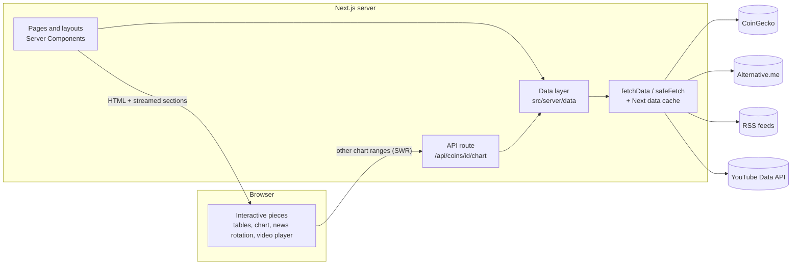

# The Kinetic Ledger

**A crypto market dashboard with live prices, sector rankings, news and video in one dark, fast interface.**

The Kinetic Ledger brings together data from CoinGecko, Alternative.me, three crypto news outlets and YouTube on one site.
It is built with **Next.js 16 (App Router)**, **React 19**, **TypeScript** and **Tailwind CSS v4**. Most of the work happens on the server, so pages arrive already filled in, and the free API plans it depends on stay within their limits.

> Built as a hands-on learning project: every feature below was designed, built and checked by hand on desktop, tablet and phone.

---

## Contents

1. [Feature tour](#1-feature-tour)
2. [Tech stack](#2-tech-stack)
3. [Architecture](#3-architecture)
4. [Data sources](#4-data-sources)
5. [Caching and the API budget](#5-caching-and-the-api-budget)
6. [Engineering details worth a closer look](#6-engineering-details-worth-a-closer-look)
7. [Design system](#7-design-system)
8. [Accessibility](#8-accessibility)
9. [Security and privacy](#9-security-and-privacy)
10. [Project structure](#10-project-structure)
11. [Running it locally](#11-running-it-locally)
12. [Deployment](#12-deployment)
13. [Roadmap](#13-roadmap)
14. [Credits and disclaimer](#14-credits-and-disclaimer)

---

## 1. Feature tour

### Everywhere on the site

| Feature | What it does |
|---|---|
| **Live ticker** | A scrolling strip of the top 30 coins (stablecoins left out) with price and 24h change. It pauses on hover, and every coin links to its page. A placeholder bar appears while prices load, so the ticker never holds up the rest of the page. |
| **Header and mobile nav** | Desktop navigation with the current page highlighted, plus a bottom tab bar on phones (Pulse, Markets, Rank, News, Videos). |
| **Loading skeletons** | Every page and every home section has a grey placeholder the same size as the real content, so nothing jumps around when the data arrives. |
| **Graceful failure** | If one API is down, only its card says "unavailable" and the rest of the page still works. Unknown URLs get a styled 404 page, and unexpected errors get a "try again" screen. |

### Home page: the overview

- **Market overview cards (4)**
  - **Total Market Cap:** the value, 24h change, trading volume and a 24-hour sparkline.
  - **Dominance:** a donut chart of Bitcoin, Ethereum and everything else.
  - **BTC Halving:** a progress ring counting the days to the next halving, with the block reward before and after.
  - **Fear & Greed:** a half-circle gauge with a needle, coloured by Alternative.me's sentiment bands, plus yesterday's and last week's values.
- **The Terminal (news):** a large lead story that moves to the next of the 5 newest illustrated stories every 8 seconds. It pauses on hover or keyboard focus, has a pause button, and you can jump to any story. Next to it, a timeline lists the 6 latest headlines with local times and source logos, and the story currently in the lead slot is highlighted. A source switcher filters by All, CoinDesk, CoinTelegraph or Decrypt.
- **Trending Sectors:** the categories trending on CoinGecko right now, with their 24h move and their top coins.
- **Market Rankings:** the top 10 coins with 1h, 24h and 7d change and market cap. Click anywhere on a row to open that coin.
- **Trending coins:** the 10 most searched coins on CoinGecko.
- **Trending NFTs:** a side-scrolling row of hot collections with floor price and volume.
- **Kinetic Broadcast:** a featured YouTube video plus an "Up Next" list from leading crypto channels, playing on the page itself.

### Markets: `/markets`

- A one-line summary: *"The global cryptocurrency market cap today is $X Trillion, a Y% change in the last 24 hours."*
- **Highlights** that can be switched on and off:
  - A market cap and volume card with a 24h area chart.
  - The top 5 trending coins.
  - The top 5 gainers, ignoring coins with less than $1M of volume so tiny illiquid coins don't dominate.
- **All coins table:** the top **250** coins, which you can search by name or symbol, sort by any column and page through 50 at a time. On phones, less important columns are hidden so the table never scrolls sideways.

### Coin pages: `/coins/[id]`

- **Header:** logo, name, symbol and rank, the live price with its 24h change, and a 24h low/high range bar.
- **Interactive price chart:** a TradingView *lightweight-charts* area chart with volume bars and 5 ranges (24H, 7D, 1M, 3M, 1Y). The 7-day range arrives with the page; the others load when you click them.
- **Performance strip:** price change over 1h, 24h, 7d, 14d, 30d and 1y.
- **Key stats:** market cap, fully diluted value, volume, circulating, total and max supply (with a progress bar), and the all-time high with how far the price is below it.
- **Links:** website, whitepaper, block explorers, community and source code. Only safe `http(s)` links are shown.
- **About:** the project description, always shown as plain text and never as HTML.
- **Latest news:** headlines that name the coin or its ticker as a whole word. "ETH" matches "ETH/BTC" but not "Ethena".
- The browser tab title is set per coin, for example *"Bitcoin (BTC) Price"*. A page skeleton and a "Coin not found" page are included.

### Rankings: `/rankings`

- Every crypto **sector** (Layer 1, DeFi, Meme, AI, RWA and so on), ranked by total market cap.
- Highlight cards for the largest sector, the top 24h gainer and the top loser (both limited to sectors worth at least $100M), and how many sectors are tracked.
- A searchable, sortable table with each sector's three largest coins (linked) and a bar showing its share of market cap.

### News: `/news`

- **CoinDesk, CoinTelegraph and Decrypt merged into one feed**, with duplicates removed and newest first.
- Source filter chips that show how many stories each source has, a large lead story, a grid of cards and a "Load more" button.
- Publish times are formatted on the server in UTC, so the page never shows one time and then flips to another as it loads.

### Videos: `/videos`

- The latest **long-form** videos from Coin Bureau, DataDash, Cameron Fous and Bankless. YouTube Shorts and live streams are left out.
- A large player with details on the side, filter chips per channel, and a grid of cards. Clicking a card plays that video and scrolls up to the player.
- Channel logos appear next to the channel names, and videos play from the privacy-friendly `youtube-nocookie` domain.

---

## 2. Tech stack

| Layer | Technology | Why |
|---|---|---|
| Framework | **Next.js 16.2** (App Router, Turbopack) | Server Components, streaming, cached page regeneration (ISR), API routes and file-based routing |
| UI | **React 19.2** with the **React Compiler** | Memoizes automatically and enforces strict rules for hooks and rendering |
| Language | **TypeScript 5** (strict) | Typed API responses, typed route props (`PageProps<"/coins/[id]">`) |
| Styling | **Tailwind CSS v4** | Design tokens defined with `@theme inline`; no separate config file |
| Class helper | `clsx` + `tailwind-merge` → `cn()` | Conditional classes without Tailwind conflicts |
| Charts | **lightweight-charts v5** (TradingView) + hand-written SVG | Fast canvas price charts; the gauge, rings and sparklines are custom SVG |
| Client data | **SWR** | Loading other chart ranges, with responses cached on the client |
| RSS | **fast-xml-parser** | Parses the three news feeds on the server |
| Fonts | `next/font/google`: Space Grotesk, Manrope, Inter | Downloaded with the site, so the text doesn't shift when fonts load |
| Icons | Material Symbols | One icon font, styled with CSS |
| Quality | ESLint 9 (`eslint-config-next`), `tsc --noEmit` | Run before every commit |
| Deployment | Vercel, or Docker (`output: "standalone"`) | Same code on a managed host or your own server |

---

## 3. Architecture

### How a page is put together

Each feature fetches its own data on the server. The page **streams** to the browser: the layout and skeletons appear immediately, and each section replaces its skeleton the moment its data is ready. A slow API delays only its own section.



### How each kind of data is loaded

| Pattern | Used for | How |
|---|---|---|
| **Server Component, cached** | Ticker, metric cards, market tables, sectors, trending | Fetched and rendered on the server. Stays cached until it's due a refresh (`revalidate`). |
| **Server fetch → client render** | The Terminal, News feed, Markets and Rankings tables, Video library | The server loads all the data once; filtering, sorting, paging and rotation then happen in the browser with no further API calls. |
| **API route + SWR** | Coin chart ranges | The browser calls *our* route, never CoinGecko directly, so the API key stays secret and every visitor shares one cached response. |

### The data layer (`src/server/data`)

Components never build API URLs themselves. They call small typed functions such as `getMarketsData()`, `getGlobal()`, `getTrending()`, `getCategories()`, `getCoin(id)`, `getAllNews()` and `getVideos()`. Each of these:

- Fetches with the refresh time set in **one central file** (`lib/cacheTimes.ts`).
- Is wrapped in React `cache()`, so several components asking for the same data during one page render share one result.
- Returns `null` or an empty list on failure instead of crashing, so pages that are built ahead of time can't break the build.
- Cleans up third-party data first: drops unsafe links, removes duplicates, sorts, and strips large fields the browser doesn't need.

---

## 4. Data sources

All free tiers.

| Data | Source | Endpoint(s) |
|---|---|---|
| Coin prices, market caps, 7-day sparklines | CoinGecko | `/coins/markets` (one call for 250 coins) |
| Global totals and dominance | CoinGecko | `/global` |
| Trending coins, NFTs and categories | CoinGecko | `/search/trending` |
| Sectors | CoinGecko | `/coins/categories` |
| Coin details and price history | CoinGecko | `/coins/{id}`, `/coins/{id}/market_chart` |
| List of valid coin ids | CoinGecko | `/coins/list` |
| Fear & Greed Index | Alternative.me | `/fng/?limit=14` |
| News | CoinDesk, CoinTelegraph, Decrypt | RSS feeds |
| Videos and channel logos | YouTube Data API v3 | `playlistItems`, `channels` |
| BTC halving countdown | Calculated | Based on the April 2024 halving and the roughly four-year cycle |

---

## 5. Caching and the API budget

CoinGecko's free (Demo) plan allows **10,000 calls a month**, and failed calls count too. An early version refreshed most data every 60 seconds and fetched the same price list three times. If someone was on the site around the clock, that could have needed **about 250,000 calls a month**.

Now all refresh times live in `src/lib/cacheTimes.ts`, with the worst case worked out:

| Data | Refreshes at most every | Worst-case calls/month |
|---|---|---|
| Market list (ticker, home table, metrics and Markets page share **one** call) | 2 min | 21,600 |
| Global data | 10 min | 4,320 |
| Trending | 30 min | 1,440 |
| Sectors | 1 h | 720 |
| List of valid coin ids | 6 h | 120 |
| Coin details / charts | 5 min, up to 6 h for the 1-year chart | only when that coin is visited |

A cached item refreshes only when someone visits after it has expired, so real usage is far below these worst-case numbers.

**Protection against made-up coin URLs.** "Not found" answers can't be cached, so a bot requesting `/coins/random-1`, `/coins/random-2` and so on could use up the monthly limit. The site keeps the list of every valid CoinGecko id (~22,800) in its cache. An id that isn't on it gets a 404 immediately, with no API call. Only the ids are stored (~400 KB), not the full 1.5 MB response.

**YouTube** costs 100 quota units per search call, so the site reads each channel's uploads playlist instead, at 1 unit per call. Videos refresh hourly and channel logos daily.

---

## 6. Engineering details worth a closer look

**A total market cap chart without the paid endpoint.**
CoinGecko's global market cap history is paid-only. The site builds its own: each of the top 250 coins comes with hourly prices for the last week, so for every hour it multiplies each coin's price by its circulating supply and adds them up. Coins with incomplete history are skipped so the line doesn't jump when a new coin appears. The 1 MB of sparkline data is then removed before anything is sent to the browser.

**No Shorts, at 1% of the cost.**
Every YouTube channel has a hidden playlist of long-form uploads only, named `UULF` + the channel id without its `UC` prefix. Reading it leaves out Shorts and live streams and costs 1 quota unit instead of 100.

**Times that match between server and browser.**
Relative times like "5 minutes ago" are a classic cause of React hydration errors, where the HTML from the server doesn't match what the browser draws. The `useNow()` hook uses `useSyncExternalStore`, which reports *no time* on the server and while the page is hydrating, so the first render shows the same UTC time the server sent. Then it switches to the visitor's local time and updates once a minute. One shared timer serves every timestamp on the page.

**Rotating news without JavaScript timers.**
The Terminal's lead story is driven by a CSS animation on the progress bar. When the animation ends (`animationend`), the next story is shown. Pausing just sets `animation-play-state: paused`. If the visitor's system asks for reduced motion, the animation is turned off, so the stories don't rotate on their own.

**Custom SVG charts.**
- **Fear & Greed gauge:** a half-circle split into 5 coloured bands with small gaps between them, using the same band cut-offs as Alternative.me.
- **Dominance and halving rings:** circles drawn with a dashed stroke, each segment starting where the previous one ended.
- **Sparklines:** keep the same line thickness at any size.

The positions are all worked out before drawing, which keeps the code compatible with the React Compiler.

**Whole table rows are clickable, and still accessible.**
HTML doesn't allow a link to wrap a table row. Each row has one real link whose invisible `::after` layer stretches over the whole row. Mouse users can click anywhere; keyboard and screen-reader users get one proper link per row.

**One layout for desktop and mobile on coin pages.**
On desktop the page has two columns. On phones the column wrappers switch to `display: contents` and the cards are reordered with `order-*`. Header, chart and performance come first, then stats, links, About and news, with no duplicated markup.

**Simple, readable coin-name matching.**
Coin news uses a whole-word regular expression built from the coin's name and its upper-case ticker. Tickers shorter than 2 characters are skipped so they don't match ordinary words.

**Reusable table logic.**
`useTableState` is a generic hook for search, sort (empty values always last) and paging. Both the coin table and the sector table use it, each with its own typed sort keys.

**Dates formatted on the server.**
News dates are formatted once on the server in UTC, so the server and browser always show the same text.

---

## 7. Design system

- **Theme:** dark only, "terminal" style. Defined in `src/app/globals.css` with Tailwind v4's `@theme inline`.

  | Token | Colour |
  |---|---|
  | `primary` (gains, highlights) | `#00FFA3` |
  | `secondary` | `#00e3fd` |
  | `tertiary` | `#ac89ff` |
  | `error` (losses) | `#ff716c` |
  | `surface` | `#0b0e11` |
  | `surface-container-low / -high / -highest` | `#101417` → `#22262b` |
  | `on-surface` / `on-surface-variant` | `#f8f9fe` / `#a9abaf` |

- **Typography:** Space Grotesk for headlines and numbers, Manrope for body text, Inter for small labels (upper case, wide letter spacing).
- **Shared components:** `PageHeader`, `ChangePill` and `PercentChange` (▲/▼ with colour), `SortableHeader`, `Pagination`, `SearchInput`, `Skeleton`/`Bone`, `TimeAgo`, `Unavailable`.
- **Tailwind approach:** a repeated pattern becomes a component, conditional styles use `cn()`, global patterns go in `globals.css`, and one-off styles stay inline.

---

## 8. Accessibility

- **Correct markup:** headings, lists and tables, with `aria-sort` on sortable columns, `aria-current` for the active page or story, and `aria-pressed` on filter chips.
- **Loading states:** skeletons are marked `aria-busy`, include a screen-reader-only "Loading…" message, and hide the grey bars from assistive technology.
- **The rotating lead story:** follows the WAI carousel pattern, with a pause button, pausing on hover and focus, and live announcements only while paused.
- **Reduced motion:** pulsing skeletons, the "Live" dot and automatic rotation all turn off when the system asks for it.
- **Keyboard:** links and buttons show a visible focus outline, and decorative SVGs and icons are hidden from screen readers.
- **Phones:** tables hide less important columns on narrow screens instead of scrolling sideways.

---

## 9. Security and privacy

- **API keys stay on the server.** The CoinGecko key is sent as a request header (`x-cg-demo-api-key`), never in a URL the browser can see. The YouTube key is masked in every log line.
- **The browser never calls CoinGecko directly.** Chart ranges go through `/api/coins/[id]/chart`, which only accepts the 5 supported ranges and only valid coin ids.
- **Third-party content is treated as untrusted:**
  - Only `http(s)` links are kept from feeds and coin data (`safeUrl`).
  - Coin descriptions are always shown as plain text, never as HTML.
  - Outbound links use `rel="noopener noreferrer"`.
  - YouTube video ids are checked against `/^[\w-]{11}$/`.
- **Privacy-friendly embeds:** videos play from `youtube-nocookie.com`, and YouTube channel logos are loaded without sending a referrer.

---

## 10. Project structure

```
src/
├── app/                      # Routes: one folder per URL
│   ├── layout.tsx            # Fonts, ticker (streamed), header, footer, mobile nav
│   ├── page.tsx              # Home: each section in its own <Suspense>
│   ├── markets/              # page.tsx + loading.tsx
│   ├── rankings/
│   ├── news/
│   ├── videos/
│   ├── coins/[id]/           # page, loading skeleton, not-found
│   ├── api/coins/[id]/chart/ # Chart ranges for the client (validated, cached)
│   ├── [...slug]/            # Catch-all → styled 404 with a page title
│   ├── error.tsx, global-error.tsx, not-found.tsx
│   └── globals.css           # Theme tokens and the few global animations
├── features/                 # One folder per feature: components and types
│   ├── market/  coin/  news/  rankings/  trending/  videos/  home/  others/
├── components/
│   ├── layout/               # Header, Footer, LiveTicker, MobileNav
│   └── ui/                   # Shared building blocks (Skeleton, TimeAgo, Pagination…)
├── server/data/              # Typed, cached data functions (the only place that fetches)
├── hooks/                    # useTableState, useNow
├── lib/                      # endpoints, fetcher, cacheTimes, rss, safeUrl, formats, cn()
└── types/api.ts              # Shapes of the API responses
```

---

## 11. Running it locally

**You need:** Node.js 20+ and npm.

```bash
npm install
```

Create a `.env.local` file in the project root:

```bash
# Free "Demo" key from coingecko.com/en/developers. Optional, but strongly recommended:
# without it, requests are anonymous and rate limited much more aggressively.
COINGECKO_API_KEY=your-demo-key

# YouTube Data API v3 key (Google Cloud console, free quota). Needed for the video sections.
YOUTUBE_API_KEY=your-youtube-key
```

```bash
npm run dev     # Development server on http://localhost:3000
npm run build   # Production build (also type-checks)
npm run start   # Run the production build
npm run lint    # ESLint
```

Each section works without the others. If a key is missing or an API is down, that section shows an "unavailable" card and the rest of the site keeps working.

---

## 12. Deployment

- **Vercel:** connect the repository and add the two environment variables. Pages are cached and refreshed by the Next data cache according to `lib/cacheTimes.ts`.
- **Docker / your own server:** the app builds as a self-contained Node server (`output: "standalone"`). The `Dockerfile` has three stages (dependencies → build → small runtime image) and serves on port 3000. Pass the API keys as environment variables both when building and when running the container.

---

## 13. Roadmap

| Phase | Scope | Status |
|---|---|---|
| 1–2 | Scaffold, design tokens, layout shell, live ticker | ✅ Done |
| 3 | Market overview cards (market cap, dominance, halving, Fear & Greed) | ✅ Done |
| 4 | News: RSS parsing, The Terminal, News page | ✅ Done |
| 5 | Market tables: home top 10, Markets page with 250 coins | ✅ Done |
| 6 | Trending sectors, coins and NFTs; Rankings page | ✅ Done |
| 7 | Videos: home section and Videos page | ✅ Done |
| — | Coin pages with charts, stats, links and news | ✅ Done |
| 11 | Polish: loading skeletons, mobile layouts, API budget | 🟡 In progress |
| 8 | Accounts (Auth.js) | ⏳ Planned |
| 9 | Watchlist and portfolio (Zustand + persist) | ⏳ Planned |
| 10 | Save user data to a database | ⏳ Planned |

**Ideas after that:**
- Working search in the header
- Market heatmap
- Gainers & losers page
- Bitcoin network page (fees, hashrate, exact halving block) from mempool.space
- DeFi page (TVL, DEX volume, stablecoins) from DefiLlama
- Exchanges and derivatives (funding rates)

---

## 14. Credits and disclaimer

Market data by [CoinGecko](https://www.coingecko.com). Fear & Greed Index by [Alternative.me](https://alternative.me/crypto/fear-and-greed-index/). News from [CoinDesk](https://www.coindesk.com), [CoinTelegraph](https://cointelegraph.com) and [Decrypt](https://decrypt.co). Videos via the YouTube Data API. Price charts by [TradingView Lightweight Charts™](https://www.tradingview.com/lightweight-charts/) (attribution kept as the licence requires).

**This site is for information and education only. Nothing on it is financial advice.** Crypto prices are volatile, and the data shown can be delayed by a few minutes.
